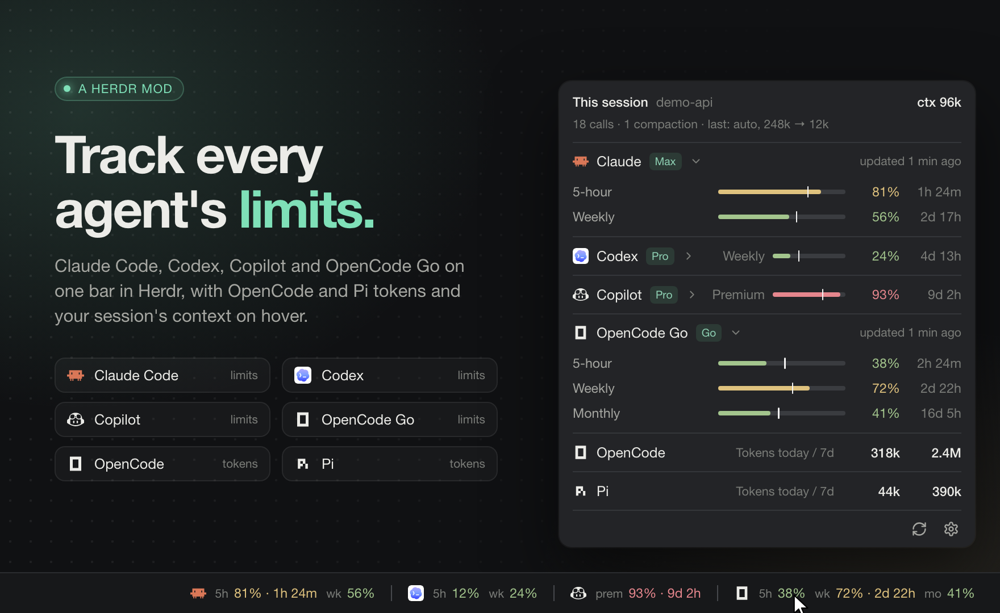

<p align="center">
  
</p>

<h1 align="center">herdr-limits</h1>

<p align="center"><strong>Know how much Claude Code, Codex, GitHub Copilot and OpenCode Go you have left, and what OpenCode and Pi have spent, without leaving your agents.</strong></p>

<p align="center">
  <a href="LICENSE"></a>
  <a href="https://herdr.dev/mods"></a>
  
  <a href="https://github.com/jibone/herdr-limits/actions/workflows/macos.yml"></a>
  <a href="https://github.com/jibone/herdr-limits/actions/workflows/linux.yml"></a>
  
</p>

<p align="center">
  <a href="#install">Install</a> · <a href="#read-the-bar">Read it</a> · <a href="#hover-for-everything">Hover</a> · <a href="#choose-what-the-bar-shows">Settings</a> · <a href="#what-it-runs">What it runs</a> · <a href="RECIPE.md">Recipe</a>
</p>

<br>

> **A fork.** This started from [nozikov/herdr-usage-limits](https://github.com/nozikov/herdr-usage-limits)
> (MIT) and now goes its own way: GitHub Copilot premium requests, OpenCode Go limits, Codex enterprise
> (monthly) limits, and whatever comes next. It doesn't track upstream.

See how much Claude Code, Codex, GitHub Copilot and OpenCode Go you have left, right in Herdr's status bar:

- **Your limits:** 5-hour, weekly and per-model, each with a bar and a percent. Codex enterprise plans show their monthly limit (`mo`), Copilot its premium requests (`prem`), OpenCode Go its 5-hour, weekly and monthly allowance (`5h`, `wk`, `mo`).
- **Everything on hover:** rest the pointer on the limits for the full picture.
- **Your current session:** how full the context is, how many messages you've sent, how many times it was compacted.
- **OpenCode and Pi:** the tokens they used today and over the last 7 days. They have no limits to show.

OpenCode session statistics support both legacy and current SQLite storage automatically.
Both appear as the same **OpenCode** block, with the same settings and counters; there is
no version selector. Schema adapters handle message and compaction differences internally.

It asks your own `claude`, `codex` and `gh` CLIs, reads OpenCode's local database and Pi's
session files, so there is no API key to add and no model usage to pay for.

## Read the bar

- **The bar** is how much of the limit you've used.
- **The tick** is how much of the time has passed. Bar past the tick? You're using it up too fast.

<div align="center">

| 🟢 Under 70% | 🟡 70–89% | 🔴 90% and up |
|:---:|:---:|:---:|
| `41%` | `74% · 2d 10h` | `92% · 38m` |

</div>

From amber on, you also see the time left until the limit resets.

## Hover for everything

Rest the pointer on the limits. The panel shows every limit and when it resets. Rest it on a
limit to see what its tick means in numbers. ↻ refreshes, ⚙ opens the settings.

Click a provider's name to fold it to one line: its tightest limit, with the bar, percent
and time to reset. Click again to open it. Everything starts open, and a fold is
remembered. An arrow beside the name shows while the pointer is on it, and always on a
folded line or when the panel holds three providers or more.

OpenCode and Pi get one line each: `Tokens today / 7d`, with both numbers. They don't
fold. One you haven't used in 7 days isn't shown.

Codex's session block includes context, calls and compactions. Embedded Codex and older
child app-servers are detected automatically. If Codex uses a shared daemon, choose the
conversation open in your terminal from **Choose Codex session** in the hover panel.
Service subagents are excluded from detection; they do not make their parent's session
ambiguous. The conversation list stays collapsed until you click the selection button.
The choice expires when that terminal's Codex process restarts; **Change Codex session**
lets you update it after `/new` or a switch to another conversation. A confirmed manual
choice in Patchbay Chat is also recognised, unless you chose a session in this mod.
Process-bound Patchbay choices survive interface reloads and are revalidated against
Codex's OS process start time, so an idle conversation keeps its statistics.
After compaction, context is hidden until Codex records fresh token usage.

The block at the top is the session in the terminal you're focused on, and it changes
when you switch terminals:

- **Context:** how much of it is filled. Codex shows a percent. Claude Code, OpenCode and Pi show tokens, because their session records don't say how big the window is.
- **Calls:** how many messages you've sent.
- **Compactions:** how many times the conversation was compacted. Claude Code and OpenCode, for now.

For OpenCode and Pi the second line also names the agent and the model: `Pi · demo-model · 2 calls`.

## Choose what the bar shows

Click ⚙ in the panel. Each provider has two boxes: the left one, under **Bar**, is about
the bar; the right one, under **Panel**, is about the panel. They are separate, and by
default the panel still shows everything. "This session" has a Panel box too. A provider
on neither the bar nor the panel isn't asked, and the session isn't read while its block
is out of the panel and none of its numbers is on the bar. Every choice, and every fold, is
remembered across restarts.

- **Claude, Codex and their limits** are on by default. Untick what you don't watch.
- **OpenCode and Pi** put today's tokens on the bar: `today 240k`. They're off the bar by default, unless no provider with limits has any numbers; then they're on.
- **Always show time to reset** adds the time to every limit, green ones too.
- **Show bars** keeps a bar beside each limit. Untick it for numbers only.
- **This session** puts the numbers on the bar: `ctx` for context, `⇄` for calls, `▼` for compactions.

## It doesn't guess

- **A failing provider says so.** Offline or signed out, it shows a dim `!` and keeps its last good reading, dimmed, with its age.
- **Old numbers look old.** Anything over 15 minutes old is dimmed.
- **A passed reset shows `—`** until the next reading, never a made-up 0%.
- **Codex's session log is only a fallback.** It's marked as a past reading, never as live.
- **Codex sessions are identified explicitly.** An open rollout or writer-lock identifies
  an embedded session. Multiple open rollouts are ambiguous; the mod offers a choice,
  rather than following whichever conversation wrote last. Shared-daemon sessions also
  require a choice. The folder only filters the list; it never selects a conversation.
- **No session rather than the wrong one.** OpenCode and Pi don't say which session a terminal shows, so the mod ties them by folder and start time, and shows nothing when that isn't certain. With one copy of the agent in the folder, `/new` takes the block away. OpenCode's then stays away until you restart it, as it does after another OpenCode wrote in that folder. Pi's is away whenever another session in the folder was written after the one this Pi started with: after another Pi that has since quit wrote in that folder (it comes back at this Pi's next reply), and after `/new` (until Pi is restarted). Right after OpenCode compacts, the block isn't shown until its next reply, as OpenCode itself has no count then. Two gaps are left: an OpenCode that hasn't sent anything since it started can show a session another short-lived OpenCode wrote in that folder, until its own first message; and with several Pi in one folder, a terminal whose Pi did `/new` keeps showing that terminal's previous session, because nothing on disk tells that apart from another Pi writing.
- **A failing token count says so too.** It keeps its last good numbers, dimmed.
- **Narrow window?** Bars go first, then labels, then the time on calm windows. Percents and providers stay.

## Install

Requires the [Herdr app](https://herdr.dev) on macOS or Linux, with the `claude` or
`codex` CLI signed in, `gh` signed in for Copilot, OpenCode signed in to OpenCode Console for
OpenCode Go (`opencode auth login`, then choose OpenCode Console; a Go API key alone
isn't enough), or OpenCode or Pi installed
(OpenCode's session block also needs `sqlite3`).

**The agent way** — tell your coding agent:

```text
Read ~/.config/herdr-app/AGENTS.md, then add this mod: https://github.com/jibone/herdr-limits
```

**By hand instead** — from a clone of this repo:

```sh
rsync -a --exclude test mods/ ~/.config/herdr-app/mods/
herdr-app check ~/.config/herdr-app/mods/usage-limits
herdr-app do layout.clone '{"name":"main","as":"my-main"}'   # if you don't have your own layout yet
```

The mod installs as `usage-limits`. Copy it, don't symlink it: Herdr won't load
icons through a link that leaves its home, and doesn't hot-reload a linked mod.
Rerun the `rsync` after pulling or editing to update the installed copy.

Then, in `~/.config/herdr-app/layouts/my-main.json`, replace the `status` block with
this row:

```json
{ "id": "status-row", "type": "row", "size": { "px": 28 }, "resizable": false, "children": [
  { "id": "status", "type": "block", "size": { "weight": 1 }, "content": { "mod": "workspace-status" } },
  { "id": "usage-limits", "type": "block", "size": { "weight": 2.2 }, "min": 130,
    "content": { "mod": "usage-limits" } } ] }
```

Give the block more weight if you want the bars to stay when a window gets tight.
If your status row is drawn without lines, `"props": { "border": false }` in the
`usage-limits` content drops the line above the bar.

## What it runs

- `sh`, your `claude` CLI, your `codex` CLI and `gh`, each briefly, every 5 minutes. They use their own sign-ins and talk to Anthropic, OpenAI and GitHub (`gh api /copilot_internal/user`, an internal endpoint). If `gh` isn't signed in inside Herdr (for example its auth is a `GITHUB_TOKEN` your shell sets), the Copilot helper starts your login shell (`$SHELL -ilc`, so your rc files run) only to read `GH_TOKEN` / `GITHUB_TOKEN`, gives up after 10 seconds, and then runs `gh` itself with that token for one call. The token is never written to disk. The mod makes no network requests itself.
- `opencode api GET /api/experimental/usage/limits`, every 5 minutes, for OpenCode Go. OpenCode's own server asks OpenCode Console using OpenCode's sign-in; the mod keeps only the 5-hour, weekly and monthly meters. Not signed in to Console, or no Go in the workspace: the block stays away and it asks once an hour.
- OpenCode's local database, read-only, for today's and seven calendar days' tokens.
  This works for both storage formats, including OpenCode installed through NVM and
  legacy CLIs without `stats --json`. Only numeric totals reach the mod. If no database
  exists, it falls back to `opencode stats --days 0 --json` and `--days 7 --json`.
  An explicit `HERDR_USAGE_OPENCODE_BIN` override also selects that CLI path.
- `hc`, to find the agent in the focused terminal, `lsof`, to find Codex's open session file, and `ps` and `lsof`, to find an OpenCode or Pi process's folder and start time. `ps` also lists your processes, to count the copies of that agent in the folder; their names and arguments stay on your machine.
- `python3` (standard library only) for Codex session statistics: it inspects the
  terminal process and its children, reads the identified rollout as JSON, and uses
  Codex's `state_*.sqlite` index read-only for writer-lock lookup and the session picker.
  The picker passes session IDs and titles to the mod; rollout message text stays in
  the helper. `CODEX_HOME` and `CODEX_SQLITE_HOME` are respected.
- It reads no token or credential file.
- It reads the focused session's log (`~/.claude/projects/`, `~/.codex/sessions/`), which holds your conversation. `helpers/session.sh` passes on numbers only. `~/.codex/sessions/**/*.jsonl` is also the fallback for Codex's limits.
- For OpenCode's session it reads OpenCode's database (`$XDG_DATA_HOME/opencode/opencode.db`, by default `~/.local/share/opencode/opencode.db`) with `sqlite3`, read-only. For Pi it reads Pi's session files (`~/.pi/agent/sessions/`): the focused session's, and those written in the last 8 days for the tokens. Both hold your conversation. `helpers/session.sh` and `helpers/pi-spend.sh` pass on only numbers (counts and times) and a model id. It never runs `pi`.

  OpenCode's storage adapters live in `helpers/opencode/`: `legacy.sql` reads
  `session` / `message` / `part`, and `current.sql` reads `session_v2` / `session_message`.
  `opencode-db.sh` detects available schemas, and `session.sql` applies one shared
  selection and counting policy. Empty migration tables do not override legacy messages;
  duplicate migrated session IDs are deduplicated, and distinct sessions remain ambiguous.
  The helper creates connection-local TEMP views in a read-only transaction and never
  changes OpenCode's database. Legacy compaction requests and synthetic continuations
  are excluded from user-call counts; only successful compactions reset context.
  Separate spend adapters include paid compactions and subagents, aggregate from local
  midnight (today and six previous days), and deduplicate migrated session IDs.
- It sends no prompt and starts no turn, so it uses no model time.
- It changes no Claude Code, Codex, OpenCode or Pi settings.

> [!NOTE]
> `get_usage` is an internal Claude Code interface, checked on 2.1.317. If an update changes it, Claude shows `!` with the error instead of numbers.

## Develop

```sh
rsync -a --delete --exclude test --exclude gpui-kit.d.ts --exclude herdr.d.ts --exclude jsconfig.json \
  mods/usage-limits/ ~/.config/herdr-app/mods/usage-limits/
npm test                                    # node --test, no dependencies
herdr-app check ~/.config/herdr-app/mods/usage-limits
```

Copy the mod, don't symlink it: Herdr won't load icons through a link that leaves its
home, so ↻ and ⚙ would be blank. Saving into the installed copy hot-reloads it, so
the `rsync` above is enough.

[RECIPE.md](RECIPE.md) is the brief to build the mod from scratch. A new provider is
one file in `providers/` plus its helper; `kind: "spend"` makes it count tokens instead
of limits. A new agent for "This session" is a mode in `helpers/session.sh` and its
Herdr name in `SESSION_MODE_BY_APP` in `io/helpers.js`.

## Credits

Forked from [nozikov/herdr-usage-limits](https://github.com/nozikov/herdr-usage-limits) by Anton Nozikov (MIT).

The approach for Claude's `get_usage` comes from
[jmalicki/herdr-mod-ai-usage](https://github.com/jmalicki/herdr-mod-ai-usage) (MIT).
`assets/hero.png` and `preview.png` are mockups of the mod with sample numbers, rendered from
`assets/src/hero.html` (headless Chrome, 880×540 at 2× and 1.591×).
The panel's icons are from [Lucide](https://lucide.dev) (ISC).

## License

[MIT](LICENSE)
